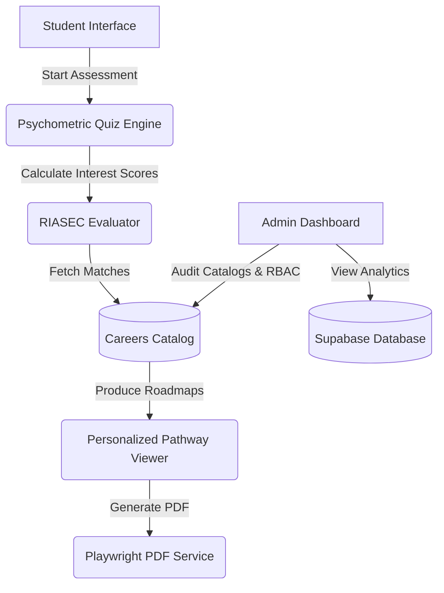

<div align="center">
  
# 🎓 Zertainity

**A student career-guidance platform for Indian Class 10 and Class 12 students, combining deterministic assessments with optional AI explanations.** <br />
*Discover, navigate, and solidify educational pathways with confidence and clarity.*

[](https://vitejs.dev/)
[](https://react.dev/)
[](https://www.typescriptlang.org/)
[](https://supabase.com/)
[](https://www.zertainity.in)

</div>

---

## 🏛️ Platform Architecture

Zertainity operates on a highly robust architecture designed to evaluate students, parse extensive catalog data, and output personalized pathways.



---

## ✨ Core Features

*   **🧠 Deterministic Career Assessments**: Validated subject and interest inputs are evaluated by the versioned analysis engine. Optional AI produces narrative explanations, not scores.
*   **🛣️ Detailed Career Roadmaps**: Step-by-step educational routes mapping secondary school choices to college degrees and professional roles.
*   **📚 Careers & Exams Catalog**: Curated frontend catalog data plus separate Supabase catalogs; verify freshness and coverage before stating record counts or official status.
*   **🏫 Integrated College Index**: Detailed institutional listings mapping universities, courses, and cutoffs.
*   **🛡️ Advanced Admin Dashboard**: Secure role-based access control (RBAC) panel for auditing data sources, content operations, and analytics.

---

## 🛠️ Technology Stack

| Layer | Technologies |
| :--- | :--- |
| **Frontend** | React 19, Vite 6, TypeScript |
| **Styling** | Tailwind CSS, shadcn/ui (Radix UI), Framer Motion |
| **State Management** | TanStack React Query (v5) |
| **Backend & Auth** | Supabase (PostgreSQL, Edge Functions, RLS) |
| **PDF Generation** | Playwright, WeasyPrint |

---

## 🚀 Getting Started

### Prerequisites
*   **Node.js** ≥ 18
*   **npm** ≥ 9

### Local Installation

1.  **Clone the Repository**:
    ```bash
    git clone https://github.com/rdp12356/zertainity.git
    cd zertainity
    ```

2.  **Install Project Dependencies**:
    ```bash
    npm install
    ```

3.  **Configure Environment Parameters**:
    Copy the sample environment file and insert your publishable Supabase credentials:
    ```bash
    cp .env.example .env
    ```

4.  **Launch Vite Dev Server**:
    ```bash
    npm run dev
    ```
    The configured Vite development server is accessible at [http://localhost:8080](http://localhost:8080).

---

## 🧭 Data flows, permissions and deployment

- **Assessment:** Students enter grades/marks and quiz answers on the React frontend. `src/analysis_engine/engine.ts` validates and normalizes inputs, scores academic/interests and career matches deterministically, and returns a versioned result. `src/pages/Results.tsx` saves personal history and creates **owner-associated** share links for authenticated users. Anonymous users can review local results without publishing a record.
- **Data:** Supabase Auth manages sessions. PostgreSQL RLS protects user profiles, history, saved careers, sharing, roles and catalog mutations. Public catalog browsing does not require login. The browser `supabase` client in `src/integrations/supabase/client.ts` uses a public publishable key, **never** a service-role key.
- **Admins:** `src/pages/Admin.tsx` displays the console; database roles, RLS and JWT-validated Supabase Edge Functions authorize privileged operations. A URL, browser role or owner email is not proof of authorization.
- **PDFs:** `src/utils/pdfGenerator.ts` formats assessment HTML and `supabase/functions/generate-pdf/index.ts` forwards requests to a Python WeasyPrint renderer in `backend/main.py`. The renderer runs separately; configure service URL(s) and shared secret in the server environment.
- **Deployment:** GitHub Actions verifies lint, test, typecheck, sitemap, dependency vulnerabilities, secret history and build. Cloudflare Pages deploys `ui-revamp` to the production domains. Supabase migrations and Edge Function deployment are separate from the frontend build.
- **Browser exceptions:** `src/lib/errorMonitoring.ts` sends privacy-minimized events to `/api/client-error`, a Cloudflare Pages Function. Inspect logs in the Pages deployment dashboard; **proactive alerts require separate Cloudflare Logpush/monitor configuration**.

## 🔐 Security and developer handoff

1. Read [HANDOFF_SECURITY.md](./HANDOFF_SECURITY.md) before handling real student data.
2. Create a feature branch from `ui-revamp`, open a PR, and require passing GitHub CI.
3. Run `npm ci`, `npm run lint`, `npx tsc --noEmit`, `npm test -- --ci`, and `npm run build`.
4. Use a disposable Supabase test project to validate RLS with two different accounts, as well as an admin/owner. **Never test permission failures by deleting or changing production records.**
5. Apply reviewed database migrations and redeploy modified Edge Functions separately from the frontend. Recheck Supabase security advisors and application smoke tests before production promotion.
6. Never commit `.env`, secret tokens, student answers, support logs containing personal information, or server `service_role` credentials. Frontend `VITE_*` values are readable by visitors.
7. Production incident triage: inspect Cloudflare Pages Function logs, Supabase Edge Function logs, Postgres logs, and GitHub Actions, then roll back the frontend deployment or the applicable migration as appropriate. Do not automatically roll back migrations that might have changed data.

## 👥 Founders

* **Johan Manoj** — Founder & Lead Developer ([rdp12356](https://github.com/rdp12356))
* **Viney Ragesh** — Co-Founder

---

## 📄 Repository Documentation Links

> [!IMPORTANT]
> Please review our guidelines and standards before editing source code or proposing changes.

*   📖 **[AGENTS.md](./AGENTS.md)**: Workspace configuration and rules for AI assistants.
*   📖 **[DESIGN.md](./DESIGN.md)**: Visual identity guidelines and design system specifications.
*   📖 **[CONTRIBUTING.md](./CONTRIBUTING.md)**: Contribution guidelines and local testing setup.
*   📖 **[CODE_OF_CONDUCT.md](./CODE_OF_CONDUCT.md)**: Community rules and standard pledges.
*   📖 **[SECURITY.md](./SECURITY.md)**: Vulnerability disclosure policies.

---

<div align="center">
  <i>Proprietary — All Rights Reserved © 2026 Zertainity. See <a href="./LICENSE">LICENSE</a>.</i>
</div>
